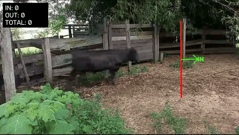

# Cow Count & Track

Count cattle crossing a line in a video. **YOLO** detects the cows, **ByteTrack** gives each one an
ID across frames, and a line counter you draw on the first frame counts the **IN** and **OUT** crossings.



## How it works

```
video ─► YOLO11 (detect "cow") ─► ByteTrack (track IDs) ─► line counter (IN / OUT) ─► results/<video>_tracked.mp4
```

- **YOLO (You Only Look Once):** an object detector that finds every object in a frame in one pass.
  It uses the small `yolo11s` model pre-trained on COCO, which already includes a `cow` class, so no
  training is needed.
- **ByteTrack:** links detections across frames. A Kalman filter predicts where each box center will
  move, and boxes are matched by overlap. A second matching pass with low-confidence detections keeps
  partly hidden cows tracked.
- **Line counter:** a cow is counted when its box center changes side of the line and stays there for
  a few frames. Each ID is counted at most once per direction.
- **Clean IDs:** a track is shown and counted only after it has lasted 15 frames, and IDs are numbered
  1, 2, 3… in order. ByteTrack's raw IDs skip numbers and include short fragments.
- **Occlusion handover:** if a cow disappears next to the line (hidden behind another cow) and a new
  track appears on the other side where that cow was predicted to be, the crossing is counted once.
  If the old ID later reappears on its original side, the count is undone.

## Installation

Requires Python 3.10+. A GPU is used automatically if available (CUDA, or MPS on Apple Silicon).

```bash
git clone https://github.com/iagocaalvo/cow-count-track.git
cd cow-count-track
python3 -m venv .venv
source .venv/bin/activate
pip install -r requirements.txt
```

The model weights (`yolo11s.pt`, about 18 MB) download automatically on the first run.

## Usage

```bash
python count.py --video path/to/video.mp4
```

1. **Draw the line on the first frame.** Click **two points** for the line, then click a **third
   point** on the side that counts as **IN**. A green arrow shows the IN direction.
   Press `Enter` to confirm, `r` to start again, `Esc` to cancel.
2. **Watch the tracking live:** boxes with `#ID confidence`, movement trails, and the IN / OUT /
   TOTAL counters. Press `q` to stop early.
3. **Get the result:** the annotated video is saved to `results/<video>_tracked.mp4` and the counts
   are printed in the terminal.

Tip: draw the line where the cows walk apart, not where they bunch up.

### Options

| Flag | Default | Description |
|---|---|---|
| `--video` | *(required)* | Input video |
| `--model` | `yolo11s.pt` | YOLO weights (`yolo11n.pt` is faster) |
| `--conf` | `0.1` | Minimum detection confidence (kept low on purpose, because ByteTrack also uses weak detections) |
| `--nms-iou` | `0.7` | Overlap above which a box is dropped as a duplicate. `0.8` keeps more boxes for overlapping cows, but may add duplicates |
| `--imgsz` | `1280` | Inference size. It is never larger than the video itself |
| `--anchor` | `center` | Point tested against the line: `center` or `bottom` |
| `--min-frames` | `3` | Frames on the new side before a crossing counts |
| `--min-track-frames` | `15` | Frames a track must last before it gets an ID |
| `--handover-frames` | `90` | Max frames a cow can stay hidden at the line and still be counted (`0` disables) |
| `--device` | auto | `cuda`, `mps` or `cpu` |
| `--tracker` | `configs/bytetrack_cows.yaml` | ByteTrack settings |
| `--output-dir` | `results/` | Output folder |

### Tracker settings

`configs/bytetrack_cows.yaml`:

- `track_buffer` (90 frames, 3 s): how long a lost cow is remembered.
- `new_track_thresh` (0.5): the confidence needed to start a new track. Higher means fewer
  false IDs.
- `track_high_thresh` / `track_low_thresh`: the confidence cut-offs for the two matching passes.

## Project structure

```
├── count.py                     # command-line entry point
├── configs/bytetrack_cows.yaml  # tracker settings
├── src/cowcount/
│   ├── line_picker.py           # pick the line + IN side on the first frame
│   ├── counter.py               # IN/OUT counting + occlusion handover
│   ├── pipeline.py              # detection → tracking → counting → video output
│   └── draw.py                  # drawing helpers
├── docs/demo.gif                # demo: full result on video 6
└── results/                     # output videos (not tracked by git)
```

## Dataset

The project was developed with the *Counting cattle Dataset*: Brangus cattle filmed with phone
cameras at the La Cordillera ranch in Rivera, Uruguay (UTEC / UNRaf / FURG). The 7 videos range from
640×352 to 1920×1080 at 30 FPS. The dataset is **not included** in this repository. Place the videos
anywhere and pass their path with `--video`.

## Limitations

- **Overlapping cows are the main source of errors.** When one cow walks behind another, especially
  black cattle against black cattle, the COCO-trained detector often boxes only the front one. The cow
  behind gets no box at all, even at very low confidence, so no tracker can follow it. It may then:
  - be **missed** if it crosses the line while hidden;
  - get a **new ID** when it reappears. This doesn't double count, but the ID numbers no longer match
    individual animals.

  The occlusion handover recovers some of these crossings, but only when the cow keeps walking at a
  steady pace. A cow that stops or turns while hidden can still be missed.
- **Tight groups:** cows walking in a tight group can go undetected entirely for some frames.
  Raising `--nms-iou` to 0.8 recovers some of them but can add duplicate boxes.
- **Moving camera:** the line is fixed on the screen, not on the ground. When the camera pans, camera
  movement alone can carry a cow across the line and produce a wrong or reversed count.
- **Line placement matters:** on the same video the count can change with where the line is drawn,
  because a different line catches different overlaps. Draw it where cows are separated.
- **Videos that end early:** cows that are tracked but haven't reached the line when the video ends
  are not counted. This is correct, but it means "cows visible" ≠ "cows counted".

## Future upgrades

- **Fine-tune the detector on these cattle, the main fix for overlap.** Train the same small
  `yolo11s` (same speed) on frames from these videos, labelling the partly hidden cows behind other
  cows. The COCO model saw few black cattle and few herds walking in a line. Plan:
  1. Pick about 300–400 frames from all videos, mostly moments when cows overlap.
  2. Pre-label them with the current model and correct them in CVAT, Label Studio or Roboflow, adding
     boxes for the partly visible cows (about 2–4 h of labelling).
  3. Train `yolo11s` (about 1 h on an Apple GPU), keeping one video out of training to test on.
  4. Compare the old and new models by watching the crossings in the output videos.
- **Camera motion compensation:** estimate camera movement between frames and move the line with the
  scene, so panning videos count correctly.
- **Appearance re-identification:** match cows that reappear after an occlusion using appearance as
  well as motion. This is limited for uniformly colored cattle.
- **Batch mode:** save a line per video (e.g. in a JSON file) so many videos can be processed without
  clicking, and export the crossings to CSV.

## Acknowledgements

- [Ultralytics YOLO](https://github.com/ultralytics/ultralytics) (AGPL-3.0) for detection and the
  ByteTrack implementation.
- [Supervision](https://github.com/roboflow/supervision) for the annotations.
- ByteTrack: Zhang et al., *ByteTrack: Multi-Object Tracking by Associating Every Detection Box*, ECCV 2022.

## License

This project is licensed under the **GNU AGPL-3.0** (see [LICENSE](LICENSE)), the same license as
Ultralytics YOLO, which it builds on.

## Dataset credit

E. de los Santos, B. de Vargas Guterres, R. Bedin Grando, *Counting cattle Dataset: Supporting
livestock Multi Object Tracking*, UTEC / UNRaf / FURG, with the La Cordillera ranch (Rivera,
Uruguay). The dataset is not redistributed here. The demo footage is used with attribution.
